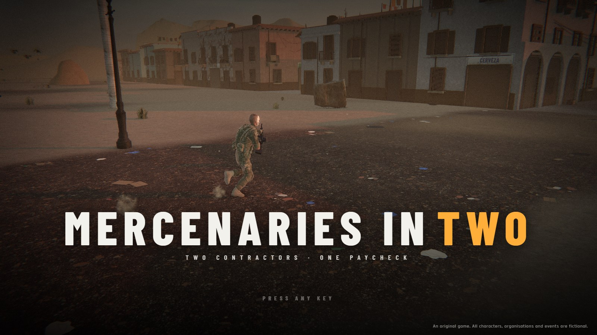
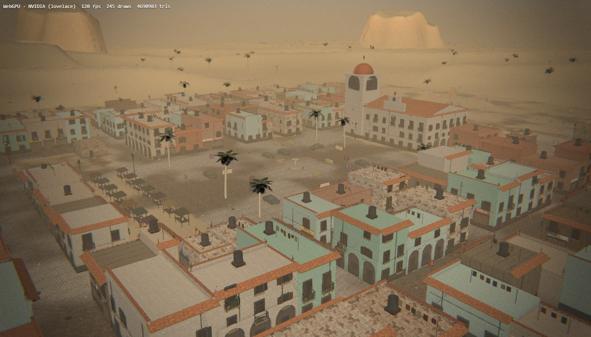
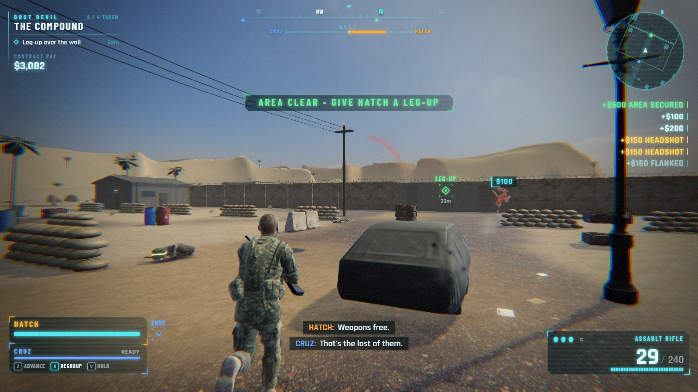
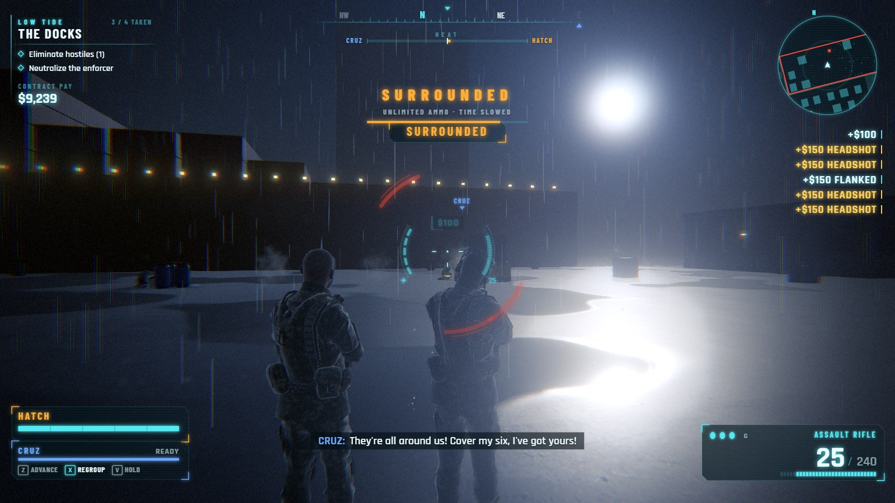
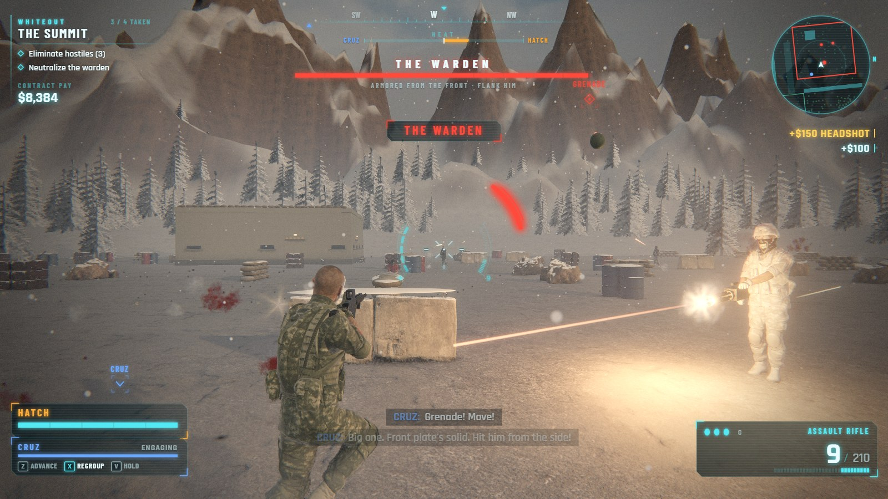
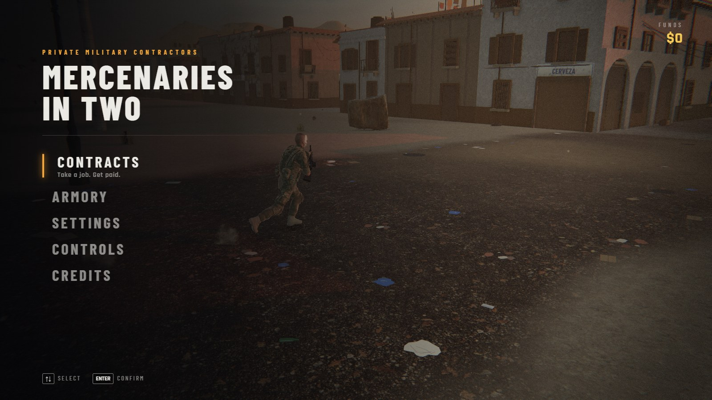

# Mercenaries In Two

**Two contractors. One paycheck.**

A co-op third-person shooter that runs in the browser. You play Hatch; Cruz, an AI partner, fights
beside you through three open-map contracts against a cartel. It's drawn on the GPU with three.js
(WebGPU, falling back to WebGL 2) and styled after the console shooters of 2010 to 2015.



## Quick start

You need [Node.js](https://nodejs.org) 22.12 or newer (24 recommended) and a desktop browser.
Browsers with WebGPU (Chrome and Edge, for example) draw with it; the rest fall back to WebGL 2 on
their own.

```bash
npm install
npm run dev
```

Then open <http://localhost:5193> and press any key. Play with keyboard and mouse or a gamepad.

## The game

Hatch and Cruz are private military contractors. A contract pays for every area you take and every
objective you finish, with bonuses for headshots, flanking and teamwork. Spend it in the armory
between jobs.

### Contracts

Contracts unlock one after another.

| Contract | Where | The job | Boss |
| --- | --- | --- | --- |
| **Dust Devil** | Desert pueblo and compound | A cartel warlord is shooting down relief flights from his walled compound past the pueblo. Take out his anti-air guns, then him. | The Warlord |
| **Low Tide** | Night port | The cartel's man at the docks is holding an engineer in a warehouse. Get in quietly, get him out loudly. | The Enforcer |
| **Whiteout** | Mountain base | The cartel has taken a mountain radar station to guide its smuggling flights. Knock it out and bring down the man who runs it. | The Warden |

### How a contract plays

- **An open map.** Each contract is a map several hundred metres across: a desert town, a container
  port, a snowy valley. Roads, streets, yards and woods connect four areas to take.
- **Any order.** Walk into an area and its defenders come at you in waves. Take the areas in any
  order, except the ones that are walled or fenced in: you get into those from the area before,
  over a wall or through a gate that opens when it's cleared.
- **Patrols** walk the roads between areas until they see or hear you. Crouch to stay unseen. An
  area's defenders won't chase you across the map; leave and they go back to their posts.
- **Objectives** along the way: set charges, free a hostage, bring down a boss.
- **Extraction.** Once every area is taken, get to the helicopter.
- The **minimap**, compass and waypoint show where to go next.



### Playing as two

- **Heat and Redline.** Shooting draws the enemy's attention to whoever's shooting (the HEAT meter
  at the top of the screen). Push it all the way and that contractor hits Redline: they hit harder
  and take less damage, and the enemies forget the other one, who can walk round and flank them.
- **Orders.** Tell Cruz to advance to forward cover, regroup on you, or hold where he is.
- **Step-jump.** Cruz gives Hatch a leg-up over walls, then follows him over.
- **Co-op snipe.** From a sniper nest, take out the marksmen on the far towers. Cruz fires with
  you, so each of your shots drops a second marksman as well (a sync shot).
- **Back-to-back.** Ambushed from every side, the two of you stand back to back: time slows and
  ammo is unlimited.
- **Going down.** A downed contractor crawls and bleeds out unless the other one revives them
  (hold Use). If you're both down, or one bleeds out, the contract fails.
- **Flanking.** Headshots and shots from the side do more damage. Heavies and bosses are armoured
  at the front, so go round them, let Cruz draw their fire, or use a grenade.

### The enemy

Riflemen fight from cover and pop up for bursts. Shotgunners rush you. Snipers hold still and paint
you with a laser before they fire. Heavies and the three bosses walk forward behind their armour,
and some throw grenades.

### Between contracts

- **Armory:** six upgrades (heavy barrel, extended magazine and stabilizer for the rifle, match
  rounds for the sidearm, body armour, a grenade belt), and nine mask designs in six colours for
  each contractor, shown on a turntable.
- **Difficulty:** Recruit, Contractor or Veteran, which sets how hard the enemy hits.
- Progress is saved in the browser (see [Saves](#saves)).

| | |
| --- | --- |
|  |  |
|  |  |

## Controls

| Action | Keyboard and mouse | Gamepad |
| --- | --- | --- |
| Move | W A S D | Left stick |
| Look and aim | Mouse | Right stick |
| Fire | Left mouse | RT |
| Aim down sights | Right mouse | LT |
| Sprint | Shift | L3 |
| Crouch | C | B |
| Vault over cover | Space | RB |
| Reload | R | X |
| Use, revive, objectives | E (hold) | A (hold) |
| Grenade | G | LB |
| Switch weapon | Q, mouse wheel, 1, 2 | Y |
| Order: advance | Z | D-pad up |
| Order: regroup | X | D-pad left or right |
| Order: hold position | V | D-pad down |
| Pause | Esc or P | Start |

## Settings

- **Graphics quality:** Low, Medium, High or Ultra. This sets render resolution, shadow detail,
  ambient occlusion, motion blur, anti-aliasing, and how many particles and how much scenery there is.
- **Renderer:** WebGPU or WebGL 2. Changing it restarts the game.
- **Field of view**, look and aiming sensitivity, and invert Y.
- **Volume** for master, music and effects, plus screen shake and subtitles.
- **Difficulty.**

## Development

### Scripts

| Command | What it does |
| --- | --- |
| `npm run dev` | Development server at <http://localhost:5193>, reloading as you edit |
| `npm run build` | Production build into `dist/` |
| `npm run preview` | Serves the production build at <http://localhost:4173> |
| `npm test` | Runs the 35 tests in Node, in about 2 seconds |
| `npm run assets` | Downloads and rebuilds the third-party assets (see [Assets](#assets)) |

### How it fits together

- **The simulation is plain JavaScript**, with no 3D library (`math.js` has its own small vector
  helpers). `Game` in `game.js` runs one mission at a fixed 60 steps a second. Drawing, the HUD and
  sound all sit outside it, so the tests can play the whole game in Node without a browser.
- **Levels are boxes.** Everything solid is an axis-aligned box, kept in a 2D grid so a body, a
  bullet or the camera only checks the boxes near it. `maps.js` lays out the three open maps and
  `level.js` builds them, finding cover points beside low boxes for the AI.
- **Getting around.** `nav.js` cuts the ground into half-metre cells and finds paths with A*. Every
  AI uses it: Cruz (`partner.js`), the enemies (`enemies.js`) and the autopilot (`bot.js`).
- **The autopilot** plays Hatch through the same input interface as the keyboard. It runs the
  title-screen demo and proves in the tests that every contract can be finished.
- **Rendering** uses three.js's WebGPU renderer. Every material and effect is written in TSL, its
  shading language, so the same shaders run on WebGPU and WebGL 2. Static geometry is merged into
  large chunks and props are instanced, to keep draw calls low on open maps.
- **The post-processing stack** (`gfx/post.js`) does ambient occlusion, light shafts, motion blur,
  bloom and lens ghosts, a filmic tone curve, FXAA or SMAA, and a colour grade with film grain.
- **Sound and music** are made at runtime with Web Audio (`audio.js`). There are no sound files.

### Project layout

```
index.html              The page: canvas, HUD canvas, menus, loading screen
src/
  main.js               Boots the game; the flow between screens; the frame loop
  game.js               One mission: areas, waves, objectives, aggro, revives, pay
  missions.js           The three contracts and their areas
  maps.js               The open maps' layouts
  level.js              Builds a level: box grid, rays, ground height, cover points
  nav.js                Navigation grid, A* paths and reachability
  player.js             Hatch: movement, aiming and shooting
  partner.js            Cruz, the AI partner
  enemies.js            Enemy behaviour
  bot.js                The autopilot
  actors.js             Bodies and enemy types shared by everyone
  weapons.js            Guns and their numbers
  physics.js            Moving bodies through the boxes
  camera.js             The over-the-shoulder camera
  input.js              Keyboard, mouse and gamepad
  hud.js                The heads-up display (a 2D canvas over the 3D view)
  ui.js, style.css      Menus
  audio.js              Synthesised sound and an adaptive score
  barks.js              What Hatch and Cruz say to each other (subtitles)
  progress.js           Money, upgrades, masks, unlocks and saving
  settings.js           Player settings and the quality presets
  preview.js            The armory's turntable
  render3d.js           The 3D view: draws a running mission
  config.js, math.js, rng.js
  gfx/                  Everything the renderer draws:
    gpu.js                The device (WebGPU or WebGL 2)
    assets.js             Loads public/assets
    characters.js, rig.js, animator.js, ragdoll.js   People, skeletons, animation, ragdolls
    guns.js, heli.js      Weapons and the extraction helicopter, modelled in code
    world.js, structures.js, town.js, dressing.js, terrain.js, foliage.js   The maps
    batch.js, materials.js, sky.js, post.js, fx.js   Geometry batching, surfaces, skies,
                                                     post-processing, particles
test/                   node:test suites, run headless
dev/                    Development pages (see below)
tools/assets/           The asset pipeline (npm run assets)
public/assets/          Built third-party assets: characters, motion capture, textures, skies, props
docs/screenshots/       The pictures in this README
```

### Dev pages

These pages work while `npm run dev` is running. They aren't part of the production build.

| Page | What it shows | Try |
| --- | --- | --- |
| `/dev/lab.html` | One scene with the real sky, surfaces, a prop and a character, through the full post stack | `?theme=port&q=ultra` |
| `/dev/people.html` | The cast posed in every state: animation, IK, masks, ragdolls | `?scene=walk&hatch=skull` |
| `/dev/guns.html` | The weapon models, side on | `?kinds=ak,rpk,goldAk` |
| `/dev/fx.html` | Explosions, impacts and gunfire on an empty stage | |
| `/dev/world.html` | A mission's map, dressed, with a camera placed by URL | `?m=0&x=-20&y=35&z=70&lx=-110&ly=0&lz=0` |
| `/dev/map.html` | A mission's layout drawn from above, with the nav grid and a test path | `?m=0&nav=1&path=-240,0,100,40` |

Most pages also take `theme` (`desert`, `port`, `snow`), `q` (quality preset) and
`backend=webgl`.

### Debugging in the browser

Development builds put a handle on `window.__dc` for the browser console:

- `__dc.autopilot()` hands Hatch to the autopilot.
- `__dc.game` is the running mission and `__dc.state` the current screen.
- `__dc.profile.on = true` records frame timings into `__dc.profile.sum` and `__dc.profile.slow`.

### Tests

`npm test` runs `test/game.test.js` with Node's built-in test runner. The tests cover:

- **Levels:** they build the same way every time, are open maps, and have paths and cover.
- **Movement:** walking, sprinting, crouching and vaulting.
- **Combat:** cover, headshots, flanking, armour and grenades.
- **Aggro and Redline.**
- **Going down and reviving.**
- **Each mission mechanic:** waves, any-order areas, gates, charges, step-jump, co-op snipe,
  back-to-back, patrols and extraction.
- **Between missions:** the armory and saves.
- **Whole contracts:** the autopilot plays each one from start to finish.

### Assets

`public/assets/` is committed, so you only need this to change or rebuild the assets.

`npm run assets` downloads every source listed in `tools/assets/manifest.mjs` into `.asset-cache/`
(ignored by git). It then converts them in headless Chrome (FBX and TGA decoding, mesh
simplification, texture resizing, glTF export) and writes the results to `public/assets/`. To
rebuild only part of it, name the parts: `node tools/assets/build.mjs avatars anims textures skies props`.

The script expects Chrome at `C:/Program Files/Google/Chrome/Application/chrome.exe`. On another
system, change `chrome` in `tools/assets/build.mjs`.

## Deploying

The game builds to static files. `npm run build` writes `dist/`, which uses relative paths, so it
runs from any folder or sub-path. Any static host works, as long as it serves the files over HTTPS:
browsers only allow WebGPU on secure pages (`localhost` counts).

### Render

`render.yaml` is a [Render Blueprint](https://render.com/docs/infrastructure-as-code) for a static
site. In the Render Dashboard, choose **New > Blueprint** and pick this repository. Render then:

1. Runs `npm ci && npm test && npm run build`, so a failing test stops the deploy.
2. Publishes `dist/` on its CDN.
3. Redeploys on every push to `main`.

It takes the Node version from `engines` in `package.json`. While the repository is private, give
Render's GitHub app access to it first.

## Saves

Progress and settings live in the browser's `localStorage`, under `mercenaries-in-two.save` and
`mercenaries-in-two.settings`. Saves from before the rename, under `double-contract.*`, still load.
Clearing the site's data starts over.

## Credits and licences

MERCENARIES IN TWO is an original game. Every character, organisation, mission, mask design, line of
dialogue and piece of music is made for it.

It uses:

- **[Microsoft Rocketbox](https://github.com/microsoft/Microsoft-Rocketbox)** (MIT) for people and motion capture.
- **[Poly Haven](https://polyhaven.com)** (CC0) for surfaces, skies and props.
- **[three.js](https://threejs.org)** (MIT) for the renderer.
- **Barlow Condensed** and **Rajdhani** (SIL Open Font License) for the interface type, loaded from Google Fonts.

The full licence texts are in [THIRD_PARTY_NOTICES.md](THIRD_PARTY_NOTICES.md), which every build
also includes.

The repository has no licence of its own yet, so the game's own code and art aren't licensed for
reuse.
